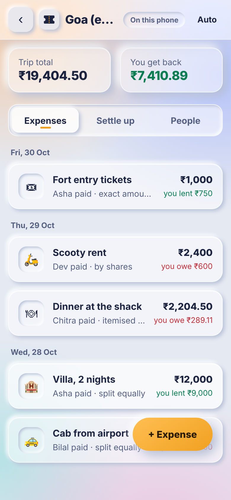
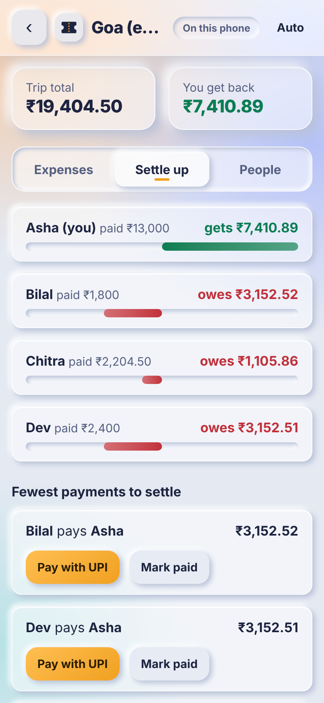
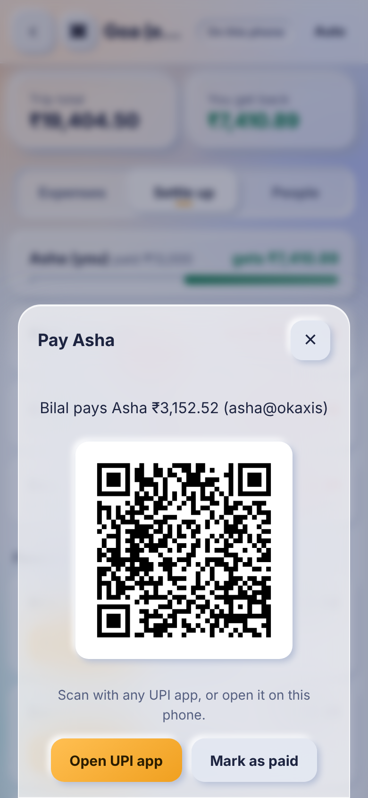
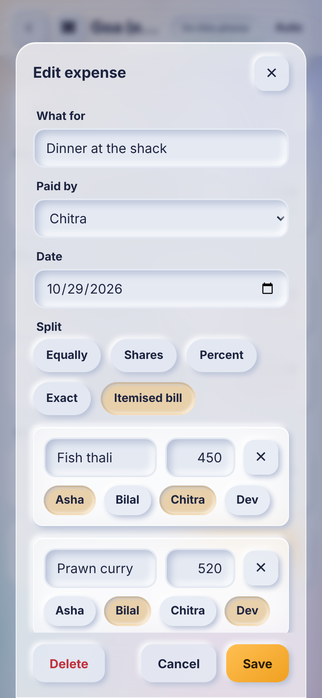
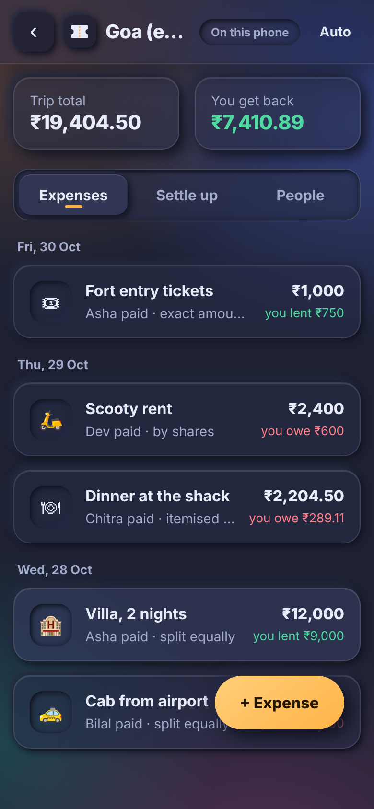

# Trip Split

Split trip expenses with friends, live. Add what everyone paid, and Trip Split works out who owes whom with the fewest payments. Settle up with a UPI QR for the exact amount.

**Try it:** https://jay-m007.github.io/Tripsplit/ (tap "Try an example" to look around)

| Expenses | Settle up | Pay on UPI | Itemised bill | Dark mode |
|---|---|---|---|---|
|  |  |  |  |  |

## What it does

- **Live for the whole group.** Start a trip and share the invite link or QR. Everyone who opens it can add expenses, and changes appear on every phone within a second. No sign-up.
- **Five ways to split.** Equally among the people you pick, by shares (one person had two portions), by percent, by exact amounts, or as an **itemised bill**, where each dish goes to the people who had it and GST, service charge and tip are shared in proportion to what each person ordered.
- **Fewest payments.** Balances for everyone, and a settle-up plan with at most one payment fewer than the number of people.
- **Pay on UPI.** If the person being paid has a UPI ID, "Pay with UPI" shows a QR for the exact amount and opens any UPI app. Mark it paid and the balances update for everyone.
- **Works offline.** Changes are saved on your phone first and sent when you are back online.
- **Group chat summary.** Copy or send on WhatsApp: who paid what and who pays whom.
- **Soft glass look.** Frosted glass panels over a colour wash, with soft raised and pressed (neumorphic) buttons and inputs. Smooth entrance motion that switches off if your phone asks for reduced motion, and a plain solid fallback if it asks for reduced transparency.
- **Light and dark mode.** Follows your phone, or choose with the button in the top bar.

## Privacy

Every change is **encrypted on your phone** (AES-256-GCM, built into the browser) before it is sent. The key lives only in the invite link, after the `#`, and browsers never send that part to any server. Supabase stores only scrambled data it cannot read: no names, amounts or UPI IDs.

People join with an anonymous sign-in, and database rules (row-level security) let only members of a trip read or add to it. Nobody can edit or delete what is already stored; changes are new entries. Anyone who has the invite link can see and edit the trip, so share it only with the group.

## How it works

A trip is a log of small events: add a person, save an expense, record a payment. Each phone rebuilds the trip from the log, ordered by time and then by id, so every phone ends up with the same result no matter what order events arrive in, even after being offline. Events from other phones are checked before use; anything malformed is ignored.

All money is whole paise. Every split is rounded once with the largest-remainder method, so the parts always add up to the exact total. The settle-up plan repeatedly matches the person who owes the most with the person owed the most.

```
engine/    split.js (five split types), balance.js (balances, settle-up), trip.js (event log), seal.js (encryption),
           invite.js, upi.js, qr.js (QR encoder, no library), money.js, summary.js
web/       index.html, style.css, app.js, sync.js (Supabase live sync), sample.js, vendor/supabase.js
supabase/  schema.sql (tables, row-level security, functions)
tests/     node --test
```

## Run your own copy

1. Create a free Supabase project. In the SQL editor, run `supabase/schema.sql`.
2. Turn on Authentication, Sign In / Providers, **Allow anonymous sign-ins**.
3. Put your project URL and publishable key in `web/config.js`, and the project address in the `connect-src` line of `web/index.html`.
4. `npm test` (17 tests), then `npm run serve` and open http://localhost:8080

Leave `web/config.js` empty and Trip Split runs with trips kept on one device. No packages to install; Node 20 or newer. Pushing to `main` runs the tests and publishes the site with GitHub Pages.

## What it is not

It is not a payment app: it never moves money, it only opens your UPI app with the amount filled in. Amounts are in rupees only.

## Licence

MIT. `web/vendor/supabase.js` is supabase-js 2.118.0 (MIT).
